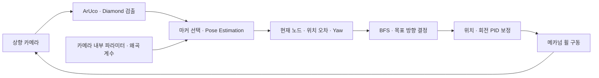

# 천장 마커 기반 자율주행 카트
### ChArUco Diamond · Camera Calibration · Pose Estimation · Visual Feedback Control

천장에 부착한 **4×4 배열의 ChArUco Diamond 16개**를 상향 카메라로 인식하고 위치와 방향을 추정해 목적지까지 이동하는 스마트 카트 프로젝트입니다.

**Raspberry Pi에서 영상 인식과 경로 탐색 및 메카넘 휠 제어를 연결**했습니다. 마커 중심의 위치 오차와 카메라에서 추정한 방향을 피드백으로 사용해 카트의 이동과 회전을 보정합니다.

**Python · OpenCV · NumPy · Raspberry Pi · Hiwonder SDK**

---

## 시연

> **[대표 시연 영상]**  
> 1번 위치에서 출발해 16번 목적지에 도착하는 전체 주행 영상

| 완성 카트 | 천장 마커 배치 |
| :---: | :---: |
| **[완성 카트 사진]** | **[4×4 천장 마커 배치도]** |
| 상향 카메라와 메카넘 휠을 장착한 카트 | 천장 노드 16개와 출발·도착 위치 |

| 출발 | 영상 인식·제어 | 도착 |
| :---: | :---: | :---: |
| **[1번 위치 출발 화면]** | **[마커 인식 화면과 제어 로그 영상]** | **[16번 목적지 도착 화면]** |
| 초기 마커 인식 | 마커 ID·좌표축·Yaw와 제어 로그 | 목적지 도착 |

---

## 프로젝트 개요

| 항목 | 내용 |
| --- | --- |
| 프로젝트 | 카트회수단 캡스톤 디자인 · 스마트 카트 |
| 목표 | 천장 영상으로 카트의 위치와 방향을 추정하고 지정 목적지까지 이동 |
| 주행 환경 | 천장에 ChArUco Diamond를 4×4 격자로 부착한 실험 환경 |
| 하드웨어 | Raspberry Pi · 상향 카메라 · 메카넘 휠 카트 |
| 주요 기술 | Camera Calibration · solvePnP · BFS · 영상 피드백 PID 제어 |
| 개인 기여 | **[담당 범위 입력]** |

## 사용 장비

| 항목 | 정보 |
| --- | --- |
| 제조사·플랫폼 | 코드의 SDK와 설치 경로 기준 **Hiwonder TurboPi** |
| 구동부 | 메카넘 휠 섀시 · Hiwonder 모터 제어 SDK |
| 카메라 | 천장을 촬영하도록 배치한 카메라 |
| 공식 제품 | [Hiwonder TurboPi](https://www.hiwonder.com/products/turbopi) |
| 장비·SDK 문서 | [TurboPi 공식 문서](https://docs.hiwonder.com/projects/TurboPi/en/standard/) |
| 구매처 | AliExpress · **Youfang Smart Store** |
| 구매 제품명 | Hiwonder Raspberry Pi AI Vision Car |
| 구매 구성 | Raspberry Pi 보드 미포함 키트 |
| 사용 보드 | 별도로 보유한 Raspberry Pi 5 |
| 구매일 | 2024.10.11 |

현재 판매되는 제품 옵션과 프로젝트 당시 구매 구성은 다를 수 있습니다.

## 시스템 구성

> **[시스템 구성도]**  
> 천장 마커 → 상향 카메라 → Raspberry Pi 영상 처리 → 위치·방향 추정 → 경로 탐색 → 모터 제어



**인식과 제어 흐름**

1. 천장 영상에서 ArUco ID와 코너를 검출하고 ChArUco Diamond를 구성합니다.
2. 영상 중심에 가장 가까운 Diamond를 선택합니다.
3. 카메라 내부 파라미터와 왜곡 계수를 적용해 `solvePnP`로 마커에 대한 상대 위치와 방향을 추정합니다.
4. Diamond ID 조합을 천장 노드에 대응시키고 BFS로 다음 이동 방향을 구합니다.
5. 마커 중심의 영상 좌표 오차와 Yaw 오차를 피드백으로 사용해 위치와 회전을 보정합니다.
6. 이동 후 갱신된 영상으로 다시 인식하고 제어합니다.

## 핵심 구현

### 1. Camera Calibration

ChArUco 보드의 코너 관측값으로 **카메라 내부 행렬 K와 왜곡 계수 D**를 구하고 저장했습니다. 저장한 파라미터를 Pose Estimation에 적용해 영상 좌표와 마커의 공간 좌표를 연결합니다.

> **[캘리브레이션 보드 사진 / 코너 검출 화면]**

### 2. ChArUco Diamond 검출과 마커 선택

`DICT_6X6_250` 사전으로 ArUco 마커를 검출하고 네 개의 ID로 구성된 Diamond를 인식합니다. 여러 Diamond가 보이면 **영상 중심과의 거리가 가장 작은 Diamond**를 선택해 현재 위치의 기준으로 사용합니다.

**천장 노드 16개와 개별 ArUco ID는 구분됩니다.** 한 노드는 네 개의 ArUco ID로 구성된 Diamond 하나에 대응합니다.

> **[검출 전·후 비교 이미지]**  
> 원본 천장 영상 → ArUco 코너·ID 검출 → Diamond 선택

### 3. Pose Estimation과 방향 시각화

Diamond의 3D 코너 좌표와 검출한 2D 코너 좌표를 `solvePnP`에 입력해 **회전 벡터 rvec과 이동 벡터 tvec**을 계산합니다.

`Rodrigues`로 회전 행렬을 구하고 마커 좌표계에서의 카메라 위치와 Yaw를 계산합니다. `projectPoints`로 좌표축을 영상에 투영해 추정 결과를 확인합니다.

> **[마커 좌표축·카트 방향·목표 방향·회전 오차 설명도]**

### 4. BFS 경로 탐색

천장 Diamond를 **4×4 격자의 노드**로 표현하고 상·하·좌·우 연결을 기준으로 BFS 경로를 계산합니다. 현재 노드와 다음 노드의 관계에서 목표 방향을 결정합니다.

**1번에서 16번으로 이동한다는 것은 출발지와 목적지를 뜻하며 모든 번호를 순서대로 방문하는 방식은 아닙니다.**

> **[BFS 경로와 이동 방향 배치도]**

### 5. 영상 피드백 PID 제어

**위치 보정**에는 Diamond 중심과 영상 중심 사이의 X·Y 오차를 사용합니다. **회전 보정**에는 목표 방향과 현재 Yaw의 차이를 사용합니다.

회전 오차는 ±180° 범위로 정규화해 가까운 방향으로 회전하도록 처리합니다. PID 출력에 따라 모터 구동을 조정하고 갱신된 영상으로 오차를 다시 확인합니다.

> **[위치·회전 보정 영상 / 보정 전·후 로그]**

### 6. 영상 캡처와 제어 처리

개발 코드에서는 카메라 캡처와 모터 제어를 별도 스레드로 구성했습니다. 프레임 하나와 캡처 시각만 보관하고 구동 펄스 이후의 새 프레임을 읽어 **최신 관측값을 처리하는 구조**를 사용했습니다.

> **[영상 캡처·인식·모터 제어 흐름도]**

## 개발 과정

### 특징점 기반 위치 추정에서 마커 기반 방식으로 전환

천장 영상으로 위치를 추정하기 위해 **ORB·SIFT·BRISK·AKAZE의 처리속도와 매칭 안정성**을 비교했습니다. 영상 전처리와 특징점 대응점 기반 Homography로 촬영 영역의 위치 추정을 시도했습니다.

이동 중 **Motion Blur로 특징점 추출과 매칭이 불안정**했고 해상도를 높이면 연산 부담이 커졌습니다. 이에 식별 가능한 ID와 코너를 제공하는 **ChArUco Diamond 기반 위치·방향 추정**으로 전환했습니다.

| 비교 항목 | 자료 |
| --- | --- |
| 특징점 매칭 | **[ORB·SIFT·BRISK·AKAZE 비교 이미지]** |
| 위치 추정 | **[Homography 기반 촬영 영역 추정 화면]** |
| 이동 조건 | **[Motion Blur 발생 화면]** |
| 방식 전환 | **[Diamond 검출·Pose Estimation 화면]** |

## 실험 결과

| 평가 항목 | 조건·결과 |
| --- | --- |
| 마커 인식 | **[해상도·카메라와 천장 거리·인식 결과 입력]** |
| 영상 처리 | **[실측 처리 시간 또는 위치·방향 갱신 주기 입력]** |
| 회전 보정 | **[보정 전·후 각도 오차와 측정 조건 입력]** |
| 위치 보정 | **[보정 전·후 중심 오차 입력]** |
| 목적지 이동 | **[시연 조건·반복 횟수·도착 결과 입력]** |

> **[결과 그래프 / 실험 로그]**

## 저장소 구성

```text
ArUco_Autonomous_Car/
├── src/
│   ├── camera.py             # 최신 프레임 캡처·타임스탬프
│   ├── calibration.py        # pinhole·fisheye 파라미터 처리
│   ├── detection.py          # Diamond 검출·ID/코너 연결
│   ├── pose.py               # PnP·Yaw·재투영 오차
│   ├── planning.py           # BFS·목표 방향
│   ├── control.py            # PID·상태 전환·모터 명령
│   ├── configuration.py      # 설정 검증
│   ├── telemetry.py          # CSV 로그
│   ├── autonomous_drive.py   # 모듈 통합 진입점
│   └── config.json
├── scripts/
│   ├── run_cart.py
│   └── calibrate_camera.py
├── experiments/              # 개발 단계별 실험 코드
│   ├── calibration/
│   ├── camera/
│   ├── vision/
│   └── control/
├── data/                     # 캘리브레이션·실험 로그
├── docs/                     # 기술 문서·사진/영상 자리
├── tests/                    # 검출·자세 추정·제어 통합 테스트
└── requirements.txt
```

## 실행 환경

- Raspberry Pi와 카메라가 연결된 Hiwonder 메카넘 휠 장비
- Python · NumPy · ArUco 모듈을 포함한 OpenCV
- Hiwonder SDK와 장비별 설정
- 사용 카메라의 내부 파라미터·왜곡 계수

```bash
pip install -r requirements.txt
python scripts/run_cart.py
# 장비에서 모터 구동 활성화
python scripts/run_cart.py --drive
```

기본 실행에서는 모터를 구동하지 않고 인식·제어 상태와 CSV를 기록합니다. 실제 모터 구동은 `--drive`로 활성화합니다. 화면 없이 실행할 때는 `--headless`를 추가합니다.

기본 캘리브레이션은 `data/calibration_param.npz`의 fisheye 파라미터와 640×480 영상 크기를 사용합니다. `diamond_side_m`은 중앙 Diamond 사각형의 실측 길이로 수정해야 합니다. 모터 부호·Yaw 기준·PID 게인과 속도는 장비에서 맞춥니다. 0.05m 등의 설정값은 초기값입니다.

**관측 실패·오래된 프레임·노드 전환 시간 초과·목적지 도착·사용자 종료 시 정지합니다.** 장애물 회피 기능은 포함하지 않습니다.

## 추가 자료

- **[프로젝트 보고서]**
- **[전체 시연 영상]**
- **[마커 인식·제어 로그 영상]**
- **[포트폴리오 링크]**

## 캘리브레이션

```bash
# 실제 인쇄한 5×5 ChArUco 보드 치수 입력 (단위: m)
python scripts/calibrate_camera.py --square 0.03875 --marker 0.01875
```

치수는 예시입니다. Space로 서로 다른 각도의 보드를 10장 이상 캡처하고 Esc로 K·D와 영상 크기 및 RMS 재투영 오차를 저장합니다. 재캘리브레이션 JSON을 쓰려면 config.json의 calibration을 ../data/calibration.json으로 바꿉니다.

## 검증

```bash
python -m unittest discover -s tests -v
```

OpenCV 4.11에서 **10개 테스트 통과**:

- 생성한 Diamond 영상의 ID·코너 검출
- pinhole·fisheye 합성 투영에서 위치 추정
- 4×4 격자 전체 출발·도착 조합의 BFS 경로
- 위치·회전·다음 노드 이동·목적지 정지 상태
- 오래된 프레임·관측 실패·전환 시간 초과 시 정지
- 모터 예외 발생 시 정지
- 검출부터 목적지 정지·CSV 기록까지 통합 흐름

실제 카트 주행과 처리속도는 장비에서 별도로 측정해야 합니다.

## 기술 문서

- [시스템 구성과 좌표·제어 상태](docs/system_architecture.md)
- [구현 구조와 개선 사항](docs/code_analysis.md)
- [개발 과정과 실험 기록](docs/research_notes.md)
- [개발 단계별 실험 코드](experiments/README.md)
- [사진·영상 배치 위치](docs/media/README.md)
