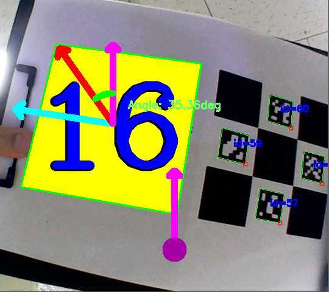
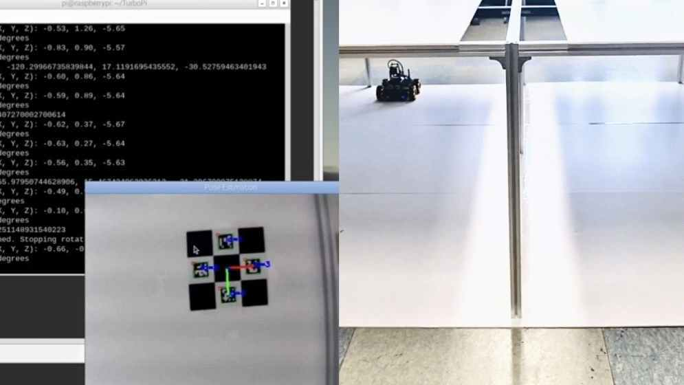
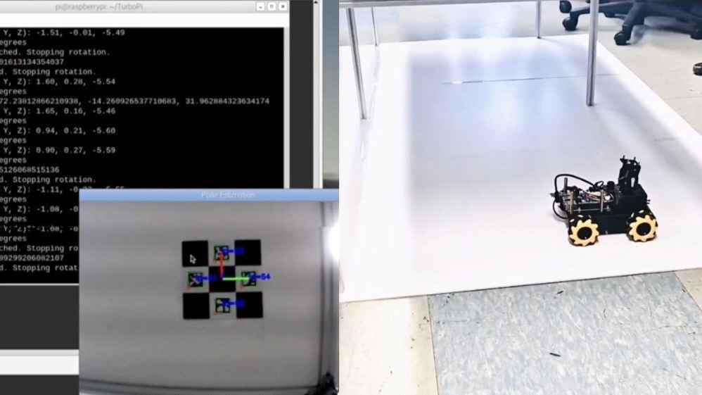

# 개발 과정과 실험 자료

## 특징점 기반 위치 추정

ORB·SIFT·BRISK·AKAZE의 처리속도와 매칭 안정성을 비교했습니다. Gaussian Blur·CLAHE 전처리와 특징점 대응점 기반 Homography로 촬영 영역 위치 추정을 시도했습니다. 이동 중 Motion Blur와 해상도 증가에 따른 연산 부담을 고려해 마커 기반 방식으로 전환했습니다.

**[알고리즘별 매칭 비교 이미지]**

**[처리속도 비교 표]**

## 마커 기반 위치·방향 추정

ChArUco 보드 캘리브레이션 → ArUco 검출 → Diamond 구성 → 가까운 Diamond 선택 → solvePnP → 위치·방향 계산 순서입니다.

**[캘리브레이션 화면]**

## 주행 제어

중심 좌표 오차와 Yaw 오차를 PID 제어에 연결하고 BFS로 다음 이동 방향을 계산했습니다.

**[보정 전·후 위치 오차]**

**[보정 전·후 회전 오차]**

| 출발 | 도착 |
| :---: | :---: |
|  |  |

## 기록할 실험 조건

| 조건 | 기록 |
| --- | --- |
| 해상도 | [입력] |
| 천장과 카메라 거리 | [입력] |
| 인식률 | [측정 횟수와 성공 횟수 입력] |
| 처리 시간 | [측정 방법과 결과 입력] |
| 회전 오차 | [목표 각도와 보정 전·후 값 입력] |

## 코드와 데이터

`experiments`에는 개발 단계별 실험 코드를 분류했습니다. `src`는 카메라 입력부터 마커 검출·위치 추정·경로 탐색·주행 제어까지 모듈별로 구성했습니다. 선택한 마커의 중심 좌표와 ID를 연결하고 중심 판정·노드 전환·목적지 정지를 구현했습니다.

기존 calib_1109.npz의 K·dists를 data/calibration.json으로 변환했습니다. 다른 calibration_param.npz에는 k_array·d_array 등 다른 키가 존재하므로 두 파일을 같은 형식으로 읽지 않습니다.
